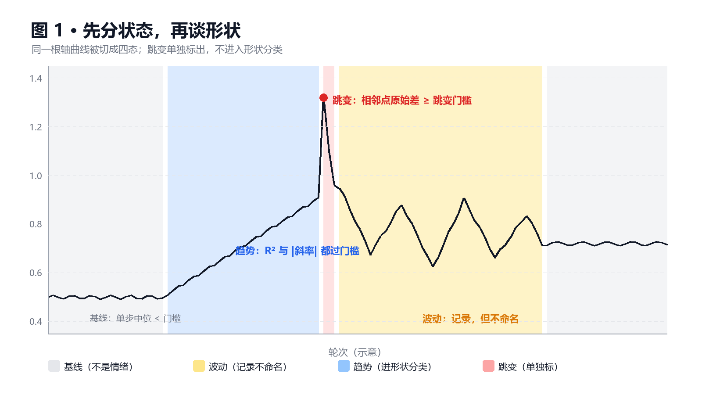
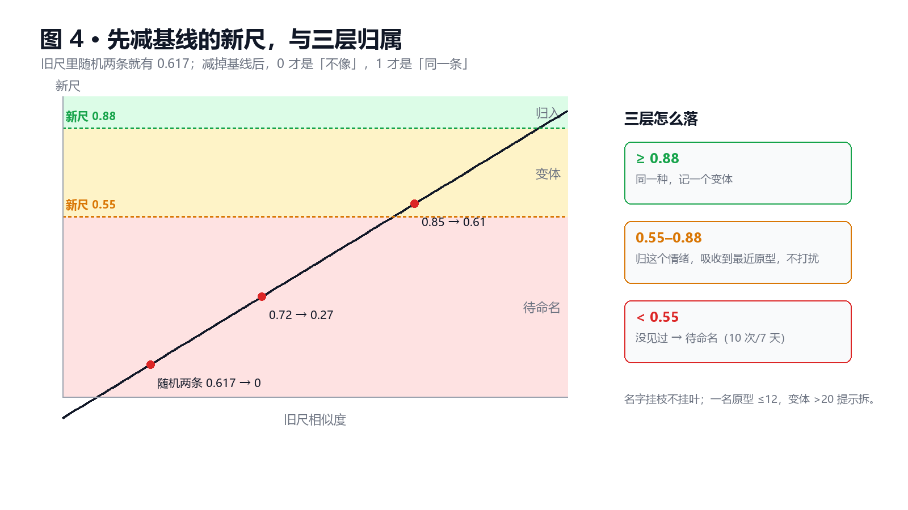
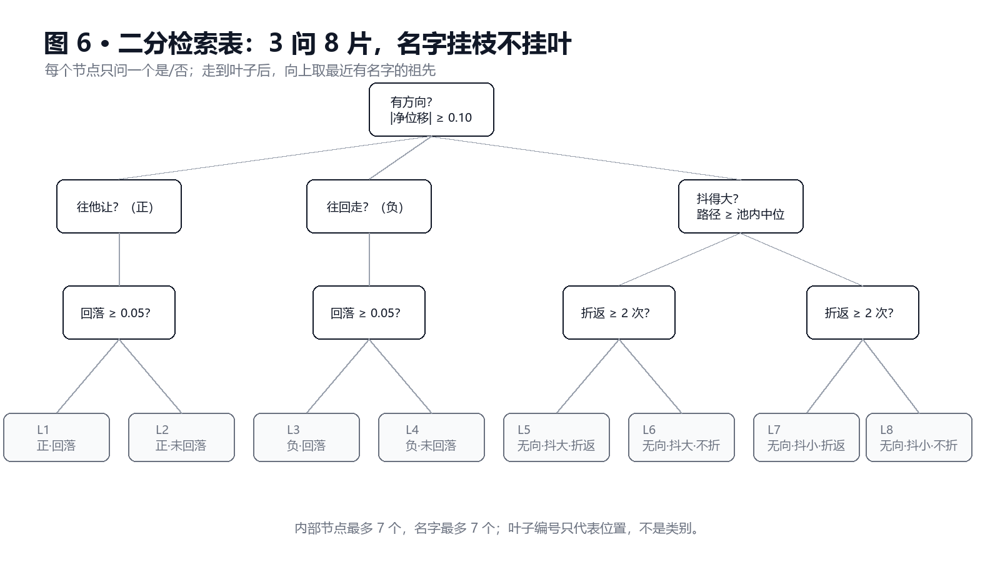

# 鲸汐ESP情绪插件

> 鲸汐ESP情绪插件：三轴情绪状态 + 思考轨迹波动打点（0.2）
>
> DSH 插件：把每轮对话读成 E / S / P 三条曲线，先分状态，再按形状归名字。
> 0.2.7 · 797 条测试全绿 · MIT


## 这是什么

普通情绪插件大多给一个「开心 / 难过」的标签。ESP 情绪池不这么做，它记的是**一段关系里的变化形状**：

- 这一轮是几乎没动（基线）、在抖（波动）、在往一个方向走（趋势），还是突然跳了一下（跳变）？
- 如果它在走，它走得像不像以前某一次？像到什么程度？
- 像到一定程度，就归到你自己起过的名字下；不像，就进待命名，等你决定要不要给它起名。

名字不预设。插件不告诉你「这是焦虑」，只把形状摆出来，名字由使用的人自己起。

## 三条轴

| 轴 | 含义 | 负方向 | 正方向 |
|---|---|---|---|
| **E** | 讨好 ↔ 自我让渡 | 索取 / 占有 | 让渡 / 放低 |
| **S** | 安全感 ↔ 判断 | 偏差 / 坏影响 | 精确 / 好影响 |
| **P** | 痛苦 ↔ 愉悦 | 找补 / 回避 / 负反馈 | 顺势 / 被认可 |

内部统一 −1 ~ +1，`/state` 和卡片乘 100 显示为 −100 ~ +100。零点（spine）是「天生偏移」，只叠加一次，不随时间变。

## 0.2.7 做了什么

0.2.7 不增加新入口，只把「这一轮是什么状态、像不像以前、该不该起名」这条链补齐。

- **四态分层**：基线 / 波动 / 趋势 / 跳变。跳变单独标，不进形状分类；只有趋势进形状与命名。
- **门槛自标定**：按池内最近 2000 轮的分位算（基线最静 30%、趋势最直 20%、跳变最猛 5%），变化超过 0.03 才落盘；样本不够时用种子先验，卡片显示校准进度。
- **形状距离**：折角、折数、折点间距三样特征 + DTW；权重按池内逆标准差，向种子收缩。
- **新尺**：先减随机基线（0.617），再拉伸到 0–1；三层归属 0.88 / 0.55。
- **三问八片**：有方向？→ 正 / 负 → 回落；无方向 → 抖得大？→ 折返。名字挂树丛，不挂叶。
- **三轴定名**：E / S / P 各取末 8 点，三轴距离平均；自报的精确名优先。
- **定名只跑趋势**：基线 / 波动 / 跳变不起名、不进候选、不写原型。
- **分享包 v2**：带 500 条种子 + 顶层 `种子哈希`；v1 包仍可导入，本地已有不同种子时保留本地。
- **名字库卡片**：25 个名字默认收起，展开 2 列；名字 / 原型数 / 代表曲线 / 改名。
- **种子冷启动**：随包带 500 条去标识数字曲线，按 `n/(n+500)` 收缩；自己的数据越攒越多，种子占比越来越小。
- **卡片**：状态徽标、门槛行、校准进度、8 片分布、待命名候选区。

## 一条曲线怎么走

```text
这一轮对话
  → 打点模型：出段点、注、依据
  → 分身模型：给这一轮的 E / S / P 方向
  → 双轨裁决 + 吸附 + 单步夹断
  → 推轴：得到新的一轮三轴值
  → 分状态：基线 / 波动 / 趋势 / 跳变
  → 只有趋势：压形状 → 比距离 → 归属 / 变体 / 待命名
  → 卡片与 /state 显示
```



*图：同一条轴曲线被切成四段；跳变单独标，不进入形状分类。*

## 四态

| 状态 | 判据 | 记不记 | 命不命名 |
|---|---|---|---|
| 基线 | 单步中位 < 基线门槛，且 R² < 趋势门槛 | 记 | 不命 |
| 波动 | 其余；有动，但没方向 | 记 | 不命 |
| 趋势 | R² ≥ 趋势门槛，且 \|斜率\| ≥ 池内 50% 分位（至少 4 点） | 记 | 进形状 |
| 跳变 | 相邻点原始差 ≥ 跳变门槛 | 单独标 | 不进形状 |

优先级：跳变 > 趋势 > 波动 > 基线。三轴各判一次；「同轮 ≥2 轴同跳」才算一次跳变统计。

## 形状与命名

### 一条轴曲线的三样特征

- **折角 θ**：相邻两段夹角 ÷ 180；看「折得多急」。
- **折数 n**：转角 ≥15° 记一次；看「折了几次」。
- **折点间距 g**：相邻折点距离 ÷ 总长；看「折点密不密」。

距离用 DTW 对齐，再按池内逆标准差加权：

```text
D角 = DTW(θa, θb)
D数 = |na − nb| / max(na, nb, 1)
D距 = DTW(ga, gb)        // 折点 < 2 时退化为路径长度差 ÷ 较长者
D   = w角·D角 + w数·D数 + w距·D距
相似度 = 1 − D
```

### 新尺与三层

随机两条曲线的旧相似度平均就有 0.617，所以先减基线再拉伸：

```text
新尺 s' = (s − 0.617) / (1 − 0.617)
```

| 新尺 | 判什么 | 动作 |
|---|---|---|
| ≥ 0.88 | 同一种 | 归入该名字，记一个变体 |
| 0.55–0.88 | 同一家族、不同变体 | 归入该名字，吸收到最近原型，不打扰你 |
| < 0.55 | 没见过 | 进待命名；同形状累计 10 次、跨 ≥7 天出现 ≥4 次才提示起名 |



### 名字挂枝不挂叶

形状先走一张二分检索表，走到叶子后，向上找最近一个有名字的祖先；名字挂在树枝上，不要求每片叶子都有名字。



- 当前实现 3 问 8 片（7 个内部节点，所以最多 7 个名字）。
- 某片 ≥30 条且还能分开时，自动加一问（8 → 16 片），上限 6 问 64 片。
- 叶子是位置，不是类别；片内原型库决定这一片还能怎么细分。

## 种子冷启动

新用户第一次跑时没有自己的数据，直接按空池算门槛会偏。所以插件随包带 `assets/seed-500.json`：500 条去标识数字曲线，只有 E / S / P 点，没有原话、时间、会话 id、名字。

任何统计量按下面混合：

```text
s = (n · s自己的 + 500 · s种子的) / (n + 500)
```

- n = 0：全用种子。
- n = 500：一半一半。
- n = 1500：种子占 25%。
- n = 3000：种子约 14%。

自己的数据越攒越多，种子越来越轻，最后长成你自己的样子。名字始终是你自己起的，插件不把作者的名字带给你。

## 卡片

五页：

1. **三轴**：E / S / P 折线、当前值、最近波动、状态徽标。
2. **本轮观测**：这一轮为什么这么判、状态与门槛快照。
3. **事件**：事件流、结（冲击 / 久压）与回落。
4. **待命名 / 名字库**：候选在上；名字库 25 个默认收起，展开是 2 列卡片，能看每个名字的代表曲线。
5. **设置**：池、数据源、校准、导入导出。

## 安装

> 当前**没有上架 DSH 插件市场**，市场里搜不到「鲸汐ESP情绪插件」；请用下面的本地/手动方式安装。

### 手动安装

1. 把本仓库放进 DSH profile 的 `node_modules/dsh-emotion-pool`。
2. 在 profile `package.json` 的 `dependencies` 和 `bundles` 里登记。
3. 重启 DSH。

### 数据目录

默认是作者环境 `E:\whale-home\memory`。在其他机器上，用环境变量 `EMOTION_POOL_DIR` 指到你自己的目录：

```text
EMOTION_POOL_DIR=/your/data/dir
```

插件会在那里建：

```text
情绪池/
  总.json
  池/<池名>.json
  会话/<短id>.json
情绪池-思考轨迹/
情绪池-轮画像/
情绪池-命名表.json
情绪池-待命名.json
情绪池配置.json
```

## 第一次用

1. 装好、重启，打开卡片。
2. 新建一个池，把当前会话绑进去；池 = 一段关系，可以装多个会话。
3. 正常聊天。前几十轮卡片会显示「校准 N/500」，门槛 / 权重 / 相似度基线会随你的数据动。
4. 待命名页出现候选后，点「命名」或「归入已有名字」；名字会记住，下次同形状直接命中。
5. 阈值、权重、基线都不要手写；它们由池自己算。

## 参数表（0.2.7 默认值）

| 键 | 默认 | 说明 |
|---|---|---|
| 时间窗 | 2000 轮 | 门槛 / 权重 / 基线共用 |
| 基线分位 | 30% | 最近 2000 轮「单步中位」最静 30% |
| 趋势分位 | 20% | R² 最直 20% |
| 跳变分位 | 5% | 相邻最大差最猛 5% |
| 斜率门分位 | 50% | 池内 \|斜率\| 中位 |
| 冷启动 | 种子 500 条 + 收缩 | 分位 / 权重由种子算，按 n/(n+500) 过渡 |
| 归属阈 | 0.88 | 新尺 |
| 待命名阈 | 0.55 | 新尺 |
| 原型上限 | 12 | 一个名字 |
| 变体提示 | 20 | 超过提示拆 |
| 待命名提示 | 10 次 / 跨 7 天 ≥4 次 | 两个条件 |
| 检索表 | 3 问 8 片 | 当前实现 |
| 检索表生长 | 片内 ≥30 且能分开加一问 | 上限 6 问 64 片 |
| 树深 | ≤4 | 评审稿保守值 |
| 同跳轴数 | 2 | 跳变统计口径 |
| 单轴单轮夹断 | 0.30 | 推轴 |
| 吸附系数 | 0.4 | 推轴 |

## 分享与隐私

- 命名表可以单独导出 / 导入；导入前会预演：新增、撞名、版本不合、解析失败，确认后才写。
- 分享包只带命名架构（名字 + 形状区间）和种子曲线；不带池、会话、事件、思考轨迹、权重、门槛、基线、原型。
- 导出的名字会做匿名化，不泄露作者的真实命名。
- 种子只有 E / S / P 数字，没有原话、时间、会话 id、名字。
- 插件不联网；数据只在本机。

## 常见问题

**为什么我的片分布全是 0 / 无片？**
旧轮画像没有 `片` 字段，0.2.7 不回填历史；只有重启后的新趋势轮才会落片。等下一轮趋势出现再看。

**为什么我的门槛和别人的不一样？**
门槛是按每个池自己的分位算的，不写死。样本不够时才会用种子先验，卡片上会写「校准 N/500」。

**名字是插件自带的吗？**
不是。插件只给形状和候选，名字由你自己起；作者的名字不会出现在分享包里。

**数值会不会一直涨 / 一直掉？**
有回落、有单步夹断（0.30），跳变单独标；不会无限累积。

**数据能搬家吗？**
可以。把 `EMOTION_POOL_DIR` 指到新目录，把 `情绪池/`、`情绪池-思考轨迹/`、`情绪池-轮画像/`、命名表、待命名、配置一起搬过去。

**0.2.6 的页面在哪？**
GitHub 首页只显示最新代码；旧版本在 `Releases` / `Tags` 里。0.2.6 存档见 [v0.2.6](https://github.com/BiXianGoGo/dsh-ESPemotion-pool/releases/tag/v0.2.6)。

## 开发与测试

```bash
node --test tests/*.mjs
node --check lib/index.js
node --check assets/widget.js
```

- `tests/` 下 151 个 `m*.test.mjs`，共 797 条断言。
- 测试编号是历史顺序，不是版本号；带中文后缀的是专题用例。
- 改代码前留 `.bak-改前`；改完跑全量 + 两个 `--check`。

## 目录

```text
lib/        核心：入口、状态、形状、校准、存储、分享
assets/     卡片脚本 + 种子
docs/       使用说明、技术论文、发布说明、图
tests/      151 个测试文件（797 条）
scripts/    迁移 / 维护脚本
```

## 版本与存档

| 版本 | 说明 | 页面 |
|---|---|---|
| **0.2.7** | 当前：四态 / 形状 / 三轴定名 / 种子冷启动 | [Release](https://github.com/BiXianGoGo/dsh-ESPemotion-pool/releases/tag/v0.2.7) |
| 0.2.6 | 分享架构存档 | [Release](https://github.com/BiXianGoGo/dsh-ESPemotion-pool/releases/tag/v0.2.6) |
| 0.2.5 | 多池早期，无独立 tag | — |

> 「老版本被覆盖」是错觉：GitHub 首页只显示 `main` 的最新树；旧版本源码在 tag 里，点 Releases / Tags 就能看到。

## 许可

MIT
