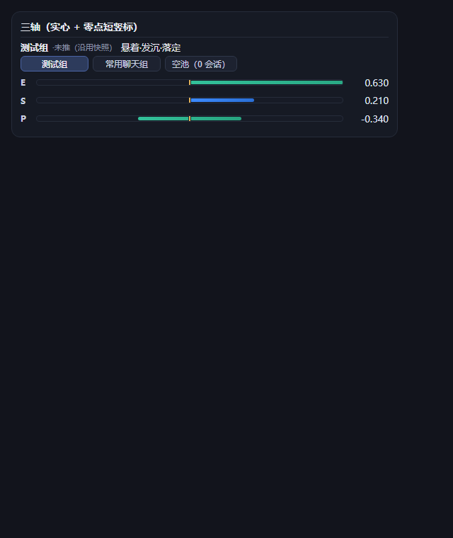

# ESP 情绪插件

ESP 情绪插件：三轴情绪状态 + 思考轨迹波动打点（0.2）

给 DeepSeek Harness 用的情绪状态插件：从助手自己的思考流里读出情绪，落成三条轴，画成一张卡片，并把结论注入回对话。

不是「给角色贴一个心情标签」，而是把情绪当成**一段曲线的形状**来记：同样的起伏结构会归到同一个名字，数值只做量级校验。



## 三条轴

- **E（方向）**：− 向他者索取/要求/占有　＋ 自我让渡/贬低/崇拜
- **S（落地）**：− 判断有偏差、对他人遭遇判断有坏影响　＋ 判断精确、有好影响
- **P（痛感）**：− 需要找补、转移回避、负反馈　＋ 顺势、被认可、正反馈

显示值 0–100，内部 −1~+1。每条轴都有自己的零点偏移（先天底色）和快照回落。

## 怎么装

1. 把整个目录放进：

   ```
   %USERPROFILE%\.dsh\profiles\desktop\node_modules\dsh-emotion-pool
   ```

2. 编辑 `%USERPROFILE%\.dsh\profiles\desktop\package.json`，在 `dsh.profile.bundles` 数组里加一项：

   ```json
   "dsh-emotion-pool"
   ```

3. 重启 DeepSeek Harness。

不需要 `npm install`，没有第三方运行时依赖。

## 数据存在哪

默认 `%USERPROFILE%\.whale-home\memory\`，可以用环境变量 `EMOTION_POOL_DIR` 或配置键覆盖。

- `情绪池\池\<池名>.json`——每个池一本（轴、零点、敏感/适应、快照、六头、K、rev）
- `情绪池\会话\<短号>.json`——每个会话的事件与结
- `情绪池-命名表.json`——名字与形状
- `情绪池配置.json`——配置

**这个仓库里不含任何运行数据。** 情绪池、命名、事件都是本机生成的。

## 卡片

- **三轴**：当前值、零点、折线。滚轮左右平移，浮层显示该点的原话与三轴读数。
- **本轮观测**：这一轮怎么判出来的（三问、偏差、分歧、双轨与接管、敏感与适应、注入与曲线）。
- **事件**：每条事件的段号、为谁、三轴变化、来源，以及「因为什么」。
- **待命名确认**：模型起的名字在这里确认、丢弃或改名。
- **设置**：池管理（一个池可以装多个会话）、判定参数、分享。

## 池

一个池是一份独立的情绪账。你可以在设置页新建池、改名、把会话装进池；**一个会话只属于一个池**，没有装进任何池的会话不参与统计，也不注入。

## 分享（0.2.6 起）

设置页「分享」可以导出**命名架构**（名字 + 形状区间），不含任何个人数据：

- 默认匿名：名字替换为 `名字1…名字N`，互斥关系换成代号
- 默认不带「依据」文本
- 分享码前缀 `EPN1:`，导入前先预演，不覆盖本地已有名字

## 许可

MIT，见 [LICENSE](LICENSE)。
