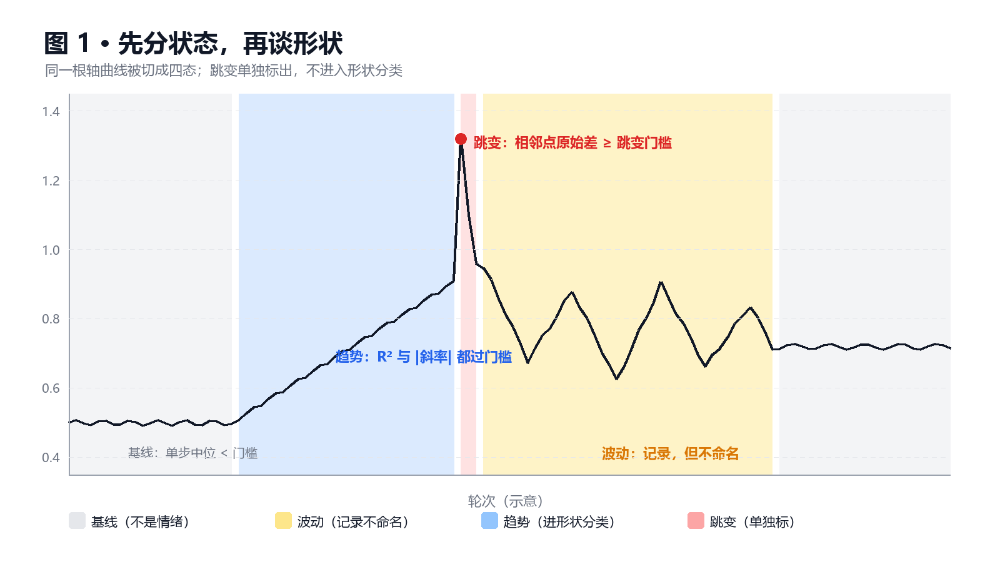
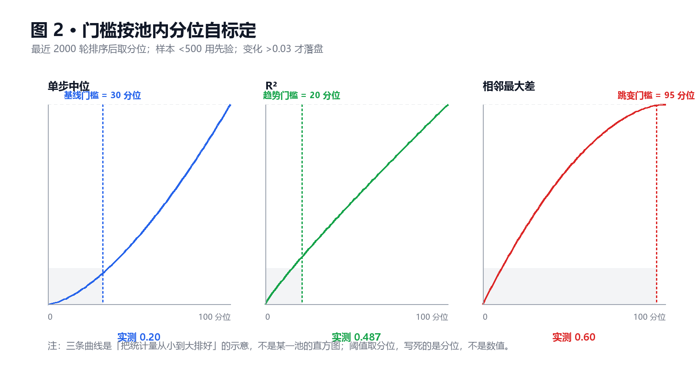
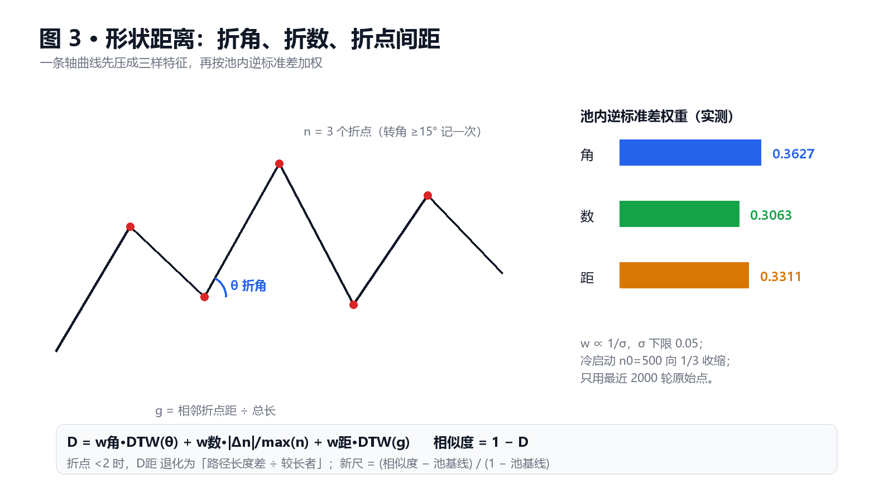
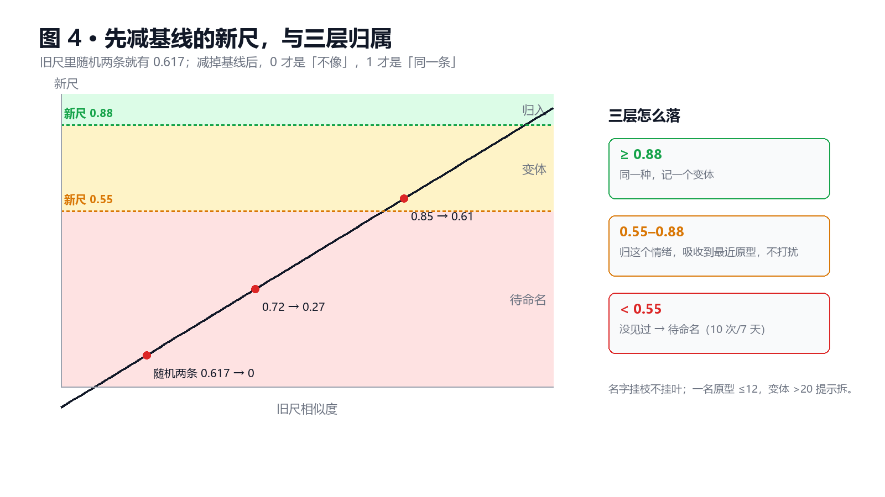
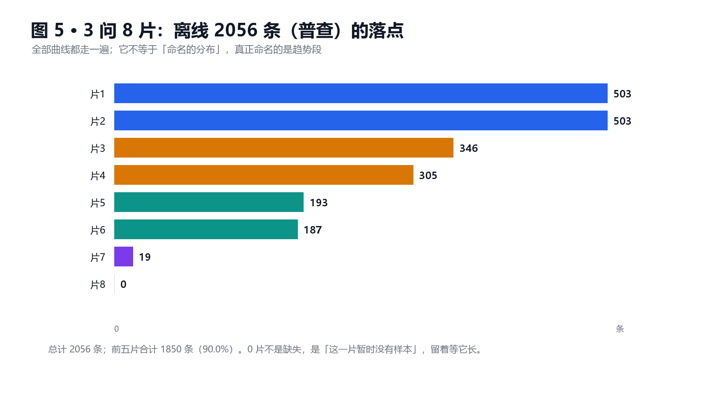
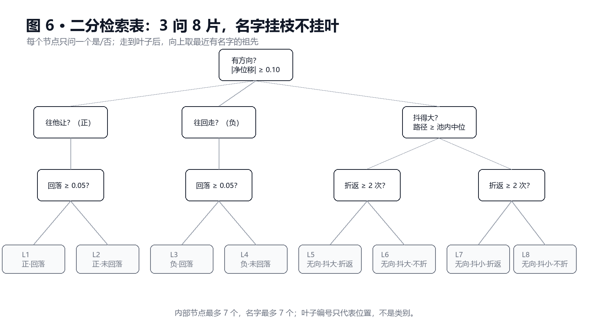

# 鲸汐 ESP 情绪池 · 技术论文（v0.2.7）

> 写于 2026-11-18，2026-11-19 下午修订（命名闭环、777→797 绿、种子随包、分享包 v2、R-3 补数）。基线是《技术论文 v0.2.6》；这一版只做一件事：把「先分状态、再分形状」讲清楚，并把门槛、距离、归属的每个数落到位。
>
> 0.2.6 论文末尾那节「0.2.7 情绪形状与状态」是 11-18 下午的中间稿，里面的跳变 26.1%、趋势门槛 0.4848、权重 0.3628/0.3079/0.3294 都已被本文 §7 的定稿数字取代；0.2.6 正文保留作历史，不再改。
>
> 本文把三件事分开写：**§2–§5 是设计口径，§7 是实测数字，§9 是还没闭合的地方**。不把「设计上应该有」写成「已经做到」。图后的「文图说明」集中在 §13，讲每张图怎么读、数据从哪来、别误读什么。

---

## 0. 摘要与设计目标

0.2.6 的定名靠 `lib/tpl.js` 的模板比对：把每一轮的整条曲线压成 `{角, 长, 位}`，和模板库比相似度，门槛 0.8、量级门 0.3。问题是它把**基线、波动、趋势、跳变**混在一起比——一条几乎不动的曲线和一条正在爬升的曲线，在同一个尺子上都只是「形状」。11-18 白天试过直接聚类：9 类、15 类，轮廓系数最高只有 0.28，说明形状在数据里是**连续谱**，没有天然的「物种」。

0.2.7 改成两层：

1. **先判状态**：这一轮是基线、波动、趋势还是跳变。基线不是情绪；波动记录但不命名；趋势才进形状分类；跳变单独标。
2. **再比形状**：只对趋势段比「折角、折数、折点间距」，减掉池内随机基线，得到新尺；新尺落在哪一层，决定归入、记变体还是进待命名。

四条设计目标不变（按优先级）：

1. **可追溯**：每个轴值都能追到哪一轮、哪句话、哪个模型判了几分、为什么。
2. **可解释**：判分必须带「因为什么」，缺了不许写入（`点合格()` 要求每点 `注` ≥3 字）。
3. **可衰减**：没有新事件时状态自己往零回，不许长期钉死。
4. **可纠错**：判错的记录留在池里但不计统计（K 值负责），而不是删掉假装没发生。

一条反面约束贯穿全文：**数值只是形状的刻度，不做情绪的唯一真相**。所有判定先看趋势，幅值只做门（量级门、单步夹断）。

---

## 1. 记号

| 记号 | 含义 | 范围 |
|---|---|---|
| E | 关系轴（− 索取/要求/占有，+ 让渡/贬低/崇拜） | 内部 −1~1，显示 ×100 |
| S | 踏实轴（− 判断偏差/坏影响，+ 精确/好影响） | 同上 |
| P | 痛感轴（− 找补/回避/负反馈，+ 顺势/被认可） | 同上 |
| 基线 | 池内「单步中位」的最静 30% 分位 | 随池 |
| 趋势门槛 | 池内 R² 的最直 20% 分位 | 随池 |
| 跳变门槛 | 池内「相邻最大差」的最猛 5% 分位 | 随池 |
| θ | 折角序列，相邻段夹角 ÷ 180 | 0~1 |
| n | 折数，转角 ≥15° 记一次 | 整数 |
| g | 折点间距 ÷ 总长 | 0~1 |
| D | 形状距离 | 0~1 |
| s | 旧尺相似度 = 1 − D | 0~1 |
| s′ | 新尺 = (s − 池基线) / (1 − 池基线) | 约 −0.2~1 |
| 原型 | 一个名字下挂的代表形状，最多 12 条 | — |

内部轴值统一 −1~1，`/state` 与卡片乘 `刻度` 后显示 −100~100。零点（`spine`）是「天生偏移」，只叠加一次，不随时间变。

---

## 2. 感知层（0.2.6 口径，未改）

系统同时跑两套判分：

- **打点模型**：看「他的一句 + 她的回复」，按轮内节奏打段点；每点附 `注`（≤12 字，是什么情绪）与 `依据`（≤5 字，因为什么）。它负责**分段**。
- **分身模型**：无记忆克隆，只读当前曲线与这一轮内容，给三轴点数（−9~9）+ 置信 `q1` + 清晰度 `q2` + `为谁`。它负责**判断方向**。

两轨点数先折算成位移：

```
Δ_轨[k] = 点数[k] × 基准(0.05) × 认知度
认知度   = K × q1 × (0.7 + 0.6·q2)          // 平时 ≤1.0
          = min(1.5, 上式 × 1.5)            // 仅当 K≥0.95 且 q1≥0.9 且 q2≥0.9
```

合成：

- 平均偏移 `偏 ≤ 0.15` → 加权中点：`点 = w·它 + (1−w)·我`，`w = 分身权重`（默认 0.7，夹 0.5~0.9）。
- `偏 > 0.15` → 按认知度四支取一轨（两轨都 <0.5 取认知度高的一方；一轨 <0.5 取另一轨；跨档取高档；平手取分身）。

落到轴上：

```
k_本轮 = clamp(0.8, 0.15, clamp(0.2, 0.8, 吸附系数) × 系数)
x_新   = x_旧 + k_本轮 · (目标 − x_旧)
|Δ_实| ≤ 0.30                      // 单轴单轮夹断
```

溢出记账不没收；τ 按速度选档 `[[0.05,12],[0.15,8],[0.3,5],[9,3]]`；快照 ≤6h 直接读、不推进。这些与 0.2.6 相同，细节见 0.2.6 论文 §2–§3。

---

## 3. 状态层：先判这一轮是什么（0.2.7 新增）

### 3.1 四态定义

三轴各判一次，整体取优先级最高者；单轴状态留在「本轮观测」页。

| 状态 | 判据 | 进不进形状 |
|---|---|---|
| **基线** | 本轮单步变化中位 < 基线门槛，**且** R² < 趋势门槛 | 不进；不是情绪 |
| **波动** | 其余（有动、但没方向、也没跳） | 记录，不命名 |
| **趋势** | 点数 ≥4，R² ≥ 趋势门槛，**且** \|斜率\| ≥ 池内 \|斜率\| 的 0.5 分位 | 进；趋势段才做形状分类 |
| **跳变** | 相邻两点原始差的最大值 ≥ 跳变门槛 | 不进；单独标 |

优先级：**跳变 > 趋势 > 波动 > 基线**。

三个细节：

- **基线看的是「单步中位」**，不是均值。一轮里有一两个大跳、其余很静，均值会被拉高；中位不会。基线要抓的是「一直在小幅晃」的那类。
- **趋势看 R² 与斜率两道**。R² 高但斜率很小，是「很直的微动」，仍算基线/波动；斜率大但 R² 低，是「抖着往上」，不算趋势。
- **跳变用原始差**，不是推轴后的差。推轴被 ±0.30 夹断，夹断后的差会低估真实跳变。观测页里能看到原始差与夹断标记。



*图 1：同一根轴曲线被切成四态；跳变单独标出，不进入形状分类。这是示意，不是某一轮的真实数据。*

### 3.2 门槛为什么不是写死的

每段关系的节奏不一样：有人一天说十句、每句都在大起大落；有人一周说一句、句句都很平。拿同一个 0.20 去卡所有人，前者全是趋势、后者全是基线。

所以门槛按**池内最近 2000 轮**的分位自标定：

| 门槛 | 取哪个统计量 | 分位 | 冷启动（种子 500 条） |
|---|---|---|---|
| 基线 | 每轮「单步变化中位」 | 最静 30% | 种子的 30% 分位（离线 2056 轮约 0.20） |
| 趋势 | 每轮 R² | 最直 20% | 种子的 20% 分位（n≥4，0.4066；2056 报告 0.487） |
| 跳变 | 每轮「相邻最大差」 | 最猛 5% | 种子的 5% 分位（0.60） |
| 斜率门 | 每轮 \|斜率\| | 50% | 种子的 50% 分位（n≥4，0.02；2056 报告 0.0286） |

冷启动不再写死绝对值。分享包带 **500 条匿名数字曲线**（只有 E/S/P 的点，没有原话、时间、sid、名字、状态），当作「已经有的 500 轮」；任何统计量按 `s = (n·s_own + 500·s_种子) / (n + 500)` 混合。n=0 全用种子；n=500 一半；n→∞ 全用池自己的。

**0.95 与 0.30 都删掉**：0.95 是我 16:45 总结表里填的，没有推导，在单步中位这把尺上等于「几乎全判基线」；0.30 正好等于「30%」这个分位数字，像是把分位当成了阈值。两个都不成立，换种子分位。

三条纪律：

- **变化 >0.03 才落盘**，旧值进 `上一版`，避免门槛每轮抖；
- **只在推轴/写池时重算**，读 `/state` 不写盘；
- **`门槛锁定` 默认关**；开了就停在当前值，不再跟数据动。

门槛行会直接写在卡片上：`门槛 基线 0.20 · 趋势 R² 0.4066 · 跳变 0.60（校准 n/(n+500)）`。看到「校准」就知道现在种子占多少。



*图 2：三条曲线是「把统计量从小到大排好」的示意，用来讲分位怎么取；不是某一池的直方图。写死的是分位，不是数值。*

### 3.3 实测：四态占比与门槛

离线 2056 轮（`bridge/reports/R-情绪形状027-离线报告-20261118.md`）：

| 项 | 值 |
|---|---|
| 基线 | 20.4% |
| 波动 | 47.2% |
| 趋势 | 26.4% |
| 跳变 | **6.1%** |
| 基线门槛 | 0.20 |
| 趋势门槛（R²） | 0.487 |
| 跳变门槛 | 0.60 |
| 斜率门 | 0.0286 |

种子 500 条（n≥4）重算：趋势 **0.4066**、斜率门 **0.02**；基线/跳变不变（0.20 / 0.60）。2056 轮报告里的 0.487/0.0286 是旧口径，留着对照。

**跳变 6.1% 是怎么来的**：同一批数据有三个口径——

- 按「任一轴跳」算：26.1%；
- 按「同轮 ≥2 轴同跳」算：**6.0%**（取整后 6.1%）；
- 按更严的「三轴同跳 + 原始差」算：约 1.5%。

差得大，是因为段点把轴量化在 0.1 的网格上：同一轮里几根轴常常一起跨格，单轴口径会把「正常的段点跳」也算成跳变。**最终用「同轮 ≥2 轴同跳」**，因为它最接近「这一轮真的被猛推了一下」的直觉。跳变在 P 轴上偏多（170 轮），也是段点内单步转折多，不是异常。

---

## 4. 形状层：只比「怎么折」，不比「折到多高」

### 4.1 一条轴曲线的三样特征

趋势段先按轴拆成一条曲线，再压成三样：

```
折角 θ  = 相邻两段夹角 ÷ 180          // 方向，幅值不进形状
折数 n  = 转角 ≥15° 的折点个数
折点间距 g = 相邻折点距离 ÷ 总长        // 节奏：折得密还是疏
```

折点 <2 时，`D距` 退化为「两条曲线的路径长度差 ÷ 较长者」；折数差仍照算。

为什么不用「绝对高度」：同一段「先沉后抬」，在 E 轴上从 −0.2 抬到 +0.2 和从 +0.3 抬到 +0.7，是同一个形状；绝对高度会把它判成两种情绪。形状只回答「怎么折」，幅值交给量级门（分享包里不带）。



*图 3：左边一条曲线压出 θ、n、g；右边是池内逆标准差权重（实测）。*

### 4.2 距离与权重

```
D角 = DTW(θa, θb)
D数 = |na − nb| / max(na, nb, 1)
D距 = DTW(ga, gb)                    // 折点<2 时用路径长度差
D   = w角·D角 + w数·D数 + w距·D距
s   = 1 − D
```

权重不写死：

```
w ∝ 1/σ          // σ 用最近 2000 轮原始点算
σ 下限 0.05
冷启动 w = (n·w数据 + 500·w种子) / (n + 500)
```

含义：哪个特征在**这个池里**更不稳定，哪个就少说话。某个池的折角本来就很抖，折角权重会自动降下去；折数稳定，折数权重就上来。权重不放进分享包；分享包带的是种子曲线，别人的权重仍由他自己的种子 + 数据算——把我们的权重直接套过去才是错的。

实测权重（2056 轮）：**角 0.3627 · 数 0.3063 · 距 0.3311**。三样差不多重，说明这批数据里没有哪个特征明显更稳；这也解释了为什么单靠「折数」分类会碎。种子 500 条重算：**角 0.3675 · 数 0.3070 · 距 0.3255**——冷启动先用这组，随样本向池内值收缩。

### 4.3 新尺：先减掉「随便两条」的基线

旧尺有一个硬伤：随机抽两条曲线，平均相似度就有 **0.617**。也就是说，0.7 听起来「挺像」，其实只比随便两条高一点；0.85 才明显。用户看 0.72 和 0.85 觉得「差很多」，公式却觉得「差不多」——尺子太松。

新尺：

```
s′ = (s − 池基线) / (1 − 池基线)
池基线 = 池内随机 300 对相似度的中位数（2056 实测 0.6249；种子 500 条 0.6044）
```

对照：

| 旧尺 s | 新尺 s′ | 读法 |
|---|---|---|
| 0.617 | 0 | 和随便两条一样 |
| 0.62 | 0.01 | 几乎没像 |
| 0.72 | 0.27 | 有一点像，但不够 |
| 0.85 | 0.61 | 像，但还不是同一条 |
| 0.955 | 0.88 | 同一条（门槛） |

新尺的 0.88 / 0.55 两道门，换成旧尺大约是 0.955 / 0.831。旧尺的 0.8 门槛，在新尺里只值 0.47——这就是为什么 0.2.6 的模板匹配总把「有点像」当成「同一种」。



*图 4：横轴旧尺、纵轴新尺；绿/黄/红是三层归属。*

---

## 5. 归属与名字：名字挂枝，不挂叶

### 5.1 三层归属

| 新尺 s′ | 判什么 | 动作 |
|---|---|---|
| ≥ 0.88 | 同一种 | 归入该名字，记一个变体 |
| 0.55–0.88 | 同一家族，不同变体 | 归入该名字，吸收到最近原型；**不打扰用户** |
| < 0.55 | 没见过 | 进待命名；同一形状累计 10 次、且跨 ≥7 天出现 ≥4 次，才提示命名 |

配套上限：

- 一个名字最多 **12 条原型**；变体 >20 条时提示「可以拆」；
- 原型只在「判为变体」时写入；同一种（≥0.88）只更新计数，不新增原型；
- 名字是「区间 + 形状」两层：三轴区间负责「哪一类」，形状负责「这一类里的哪一支」。

### 5.2 3 问 8 片：先看落点，再决定要不要长

趋势段先走一张二分检索表。起始只有 3 问：

1. **有方向？** `|净位移| ≥ 0.10`
2. 有方向 → **往他让（正）还是往回走（负）？**
3. 有方向 → **回落 ≥ 0.05 吗？**
   - 无方向 → **抖得大？** `路径 ≥ 池内中位`
   - 抖得大/小 → **折返 ≥ 2 次吗？**

离线 **全部 2056 条曲线**的普查落点（图 5；不只是趋势段）：

| 片 | 条数 |
|---|---|
| 片 1 | 503 |
| 片 2 | 503 |
| 片 3 | 346 |
| 片 4 | 305 |
| 片 5 | 193 |
| 片 6 | 187 |
| 片 7 | 19 |
| 片 8 | 0 |

前三位是「正·未回落」「正·回落」「无方向·抖大·折返」；前五片合计 1850 条（90.0%）。第 8 片是 0，不是缺失——**空叶留着**，等它长。

**这张表的身份**：它是「全部 2056 条曲线都走一遍」的普查，不是「真正命名的分布」。真正进入命名的是趋势段。

22:1x 接线后的 2316 轮全状态走表（跳变 138 不进表，走表 2178；路径中位 1.10）：

| 片 | 1 | 2 | 3 | 4 | 5 | 6 | 7 | 8 |
|---|---|---|---|---|---|---|---|---|
| 条数 | 446 | 531 | 300 | 412 | 214 | 16 | 113 | 146 |

**R-3 已补**：只让趋势走表，2323 轮里趋势 741 条，8 片落点：

| 片 | 1 | 2 | 3 | 4 | 5 | 6 | 7 | 8 |
|---|---|---|---|---|---|---|---|---|
| 趋势条数 | 199 | 212 | 74 | 139 | 50 | 7 | 32 | 28 |

741 条，前五片 674 条（91.0%）。**8 个叶子全有样本**——5/6 叶只有 50/7 条，但不是空叶。趋势不等于有净方向：R² 和斜率过了，净位移仍可能 <0.10，所以「无方向」四片在趋势里也会出现。结论：**只让趋势走表就够了**，不需要把基线/波动也拉进表；R-4 原先担心的「4 个无方向叶会死」是误判。



*图 5：八片的条数；片号只代表位置，不是类别。*

### 5.3 检索表怎么长

- 当前只实现 **3 问 8 片**（7 个内部节点，所以最多 7 个名字）。
- 某片 ≥30 条、且片内还能分开时，**自动加一问**（8 → 16 片），上限 6 问 64 片；叶子 <3 条标「样本不足」。
- **名字挂枝不挂叶**：走到叶子后，向上找最近的有名字的祖先；整枝都没名字，显示「未命名（第 n 丛）」。
- 叶子是**位置**，不是类别；片内原型库决定这一片里还能怎么细分。所以「叶子数固定」不会把树框死。



*图 6：每个节点只问一个是/否；走到叶子后向上取最近有名字的祖先。*

### 5.4 命名闭环：从「有树没原型」到「新段能自己长原型」

11-19 上午把命名链路接上了（`bridge/reports/R-命名闭环-20261119.md`，787 绿；分享包 v2 后全套 797）。现在的新段走这条闭环：

1. 趋势轮 `定名波动` 判到 `<0.55`（或没有原型可比）时，`记待命名` 把**末 8 个点**一起写下；同格只加次数，旧条缺点会补上。
2. `/tpl` 读待命名表，候选行显示 `E/S/P + 次数 + 有无曲线 + 旧标记`；旧条（`点:[]`）仍可命名，但原型为空，页面标「无曲线，仅区间」。
3. 用户起名 → `/tpl/confirm` 用该条的末 8 点写区间（±0.075，每轴至少 0.15）和**第一条原型**；之后同形状再出现，就能按三层归属命中。
4. `应用导入` 也写 `原型`（≤12）；分享包 v2 带种子、不带原型，v1 旧包照常导入。

命名表现状：25 个名字，**18 个已有原型（共 75 条）**，7 个还没有样本（牵挂 / 悬心 / 酸楚 / 暖 / 满 / 委曲求全 / 不知所措）。18 份原型是从 11-08/09 的 0.2 时代旧段里迁入的，按主人 11-19 的要求「保留旧名，找相似原型；与 0.2 冲突的才不要」处理；区间两两重叠都 <0.6，没有因冲突删除的名字。

旧 363 条待命名仍是 `点:[]`（老条没有曲线，按约定不回溯）；新条从下一次趋势轮开始带点。注入路径也已收窄到趋势轮：非趋势不再写无曲线待命名；全套测试 797。

### 5.5 名字库卡片（UI，0.2.7）

待命名页原来把 25 个名字竖排平铺，只有名字和次数，没有曲线。现在改成：

- `/tpl` 每项多 `有原型 / 原型数 / 样本`；样本取「点最多的原型」，三轴按最短对齐，不补假点。
- 「模板」改「名字库」，默认收起；展开后 2 列卡片：名字 + 原型数 + 代表曲线（无样本灰）+ 改名。
- 待确认新条在上，最多 10 条；旧条 363 折成一行「旧条目 363 · 无曲线」，点开只列前 5 条。
- 只读展示：不写池、不改命名规则。`tests\m156` 5 条，全量 797。

---

## 6. 与 0.2.6 的差异：旧模板路径下线

0.2.6 的 `lib/tpl.js` 模板匹配（0.8 门槛、0.3 量级门、方向门）不再参与定名。现在的顺序是：

1. **自报精确名**：名字在命名表里，直接用；
2. **未登记的自报名**：定名 `null`，来源写「自报未登记」，进候选区（不写模板）；
3. **形状归属**：走 §4–§5；
4. **<0.55**：定名 `null`，不兜底。

代码位置（0.2.7 收尾时）：

- `lib\index.js:117` import 只留 `{转折提示, 签名}`，不再 import 模板判定；
- `lib\index.js:970-1060` `定名波动`：删模板签名/读模板/判模板/找模板/模板更新/写模板/加候选；`:1050/:1056` 落待命名（带末 8 点）；
- `lib\index.js:3707` 格点 `+1e-9`；`:3729` `记待命名` 存点；`:3750` 收录、`:3775` 丢弃；`:4574` 加命名写原型；`:6798` `/tpl` 读待命名表；
- `assets\widget.js:614-630` 按格点确认/丢弃；`:1699` 候选行带输入框与旧标记；
- 新增 `tests\m153-命名闭环.test.mjs`；全量 **797 pass**（含后续 m154/m155/m156），三个 `node --check` 0。

旧路径还有一个副作用：它会新建 `情绪模板.json`、把自报未登记名塞候选，并与新三层归属抢优先级。A 案把这条路径整个摘掉，只保留「读/写模板」给模板页和历史统计用——模板页还能看历史，但不再参与定名。

---

## 7. 实测数字（0.2.7 交付时）

### 7.1 离线（2056 轮）

| 项 | 值 |
|---|---|
| 四态占比 | 基线 20.4% · 波动 47.2% · 趋势 26.4% · 跳变 6.1% |
| 门槛 | 基线 0.20 · 趋势 R² 0.487 · 跳变 0.60 · 斜率门 0.0286 |
| 权重 | 角 0.3627 · 数 0.3063 · 距 0.3311 |
| 相似度基线 | 0.6249 |
| 8 片（全部 2056 普查） | 503 / 503 / 346 / 305 / 193 / 187 / 19 / 0 |
| 8 片（趋势 741 条，R-3） | 199 / 212 / 74 / 139 / 50 / 7 / 32 / 28 |
| 命名表 | 25 名，18 名有原型（75 条），7 名无 |
| 待命名 | 363 条（492 次；旧条无曲线） |

### 7.1b 种子 500 条重算（冷启动先验）

| 项 | 值 |
|---|---|
| 门槛 | 0.20 / 0.4066 / 0.60 / 0.02 |
| 权重 | 0.3675 / 0.3070 / 0.3255 |
| 相似度基线 | 0.6044 |
| 四态（2311 轮复算，2 轴同跳） | 22.0 / 47.5 / 24.6 / 6.0 |
| 8 片（2316 轮全状态，路径中位 1.10） | 446 / 531 / 300 / 412 / 214 / 16 / 113 / 146 |
| 8 片（趋势 741，只趋势走表） | 199 / 212 / 74 / 139 / 50 / 7 / 32 / 28 |

两套四态数不是矛盾：2056 是交付时的离线报告，2311 是 22:0x 用同一批轨迹加「同轮 ≥2 轴同跳」重算；差在轮数口径与跳变判定。两套都留，不硬凑。8 片也留三套口径：全曲线普查、全状态走表、趋势单独——命名只认最后一套。

### 7.2 在线（重启后 23:46 的 `/state`）

| 项 | 值 | 说明 |
|---|---|---|
| 版本 | 0.2.7 | 已加载 |
| 校准样本 | 37 / 2000 | 还在种子—分位过渡区 |
| 种子 | 500 条 | 混合比 0.0689 |
| 门槛 | 0.2069 / 0.4096 / 0.50 / 0.02 | 种子 + 本池混合；跳变混合后按 0.1 向下取整 |
| 权重 | 0.3448 / 0.3204 / 0.3348 | 会随样本动 |
| 相似度基线 | 0.6077 | 会随样本动 |
| 待命名 | 363 | 旧条未清 |

> 这张表是 23:46 重启后的现状。09:11 再读，样本 57、混合比 0.1023，门槛 0.2071 / 0.4097 / 0.50 / 0.02；趋势旧轮 23 条仍「无片」（旧轮画像没片，新轮才落）。命名闭环 787 / 分享包 v2 + 名字库 797 的代码**还没重启加载**，`/tpl` 新结构、候选行要下一次重启后可见。

**在线数字不要当定值**：样本 37 轮，离 2000 很远；卡片上会写「校准 37/2000」。等样本够了，门槛/权重/基线会自己落到池内分位，和离线那组数不会一模一样——这是设计，不是漂移。

### 7.3 待命名的分布（363 条）

- 池归属靠 30 秒内同刻轨迹旁证：272 条（74.9%）能归，>600 秒的 15 条未知；
- 常用聊天组 24 条（≥2 次 6 条、30 次）、测试组 74 条（≥2 次 17 条）、未归池 265 条（73%）；
- 次数：1 次 280 条（77.1%），2 次 60，3 次 17，4 次 1，5 次 2，7/8/12 次各 1；跨天 22 条；
- 高频簇（≥4 次，6 条）：E0.60/S0.55/P0.70 12 次、E0.65/S0.45/P0.60 8 次、E0.65/S0.55/P0.70 7 次、E0.45/S0.35/P0.25 5 次、E0.35/S0.30/P0.00 5 次、E0.40/S0.25/P0.75 4 次。

这些数字只说明「有多少东西在等」，不代表它们都该被命名。**命名是最后一步**，先把状态、形状、原型三件事做对。

---

## 8. 分享包与隐私（v2）

分享的是「情绪怎么叫的形状」，不是「谁的什么事」。

- 命名表独立文件 `情绪池-命名表.json`，格式 `EPN-names`，带 `引擎范围`；跨代只读试看，不参与命中。
- 分享码 `EPN1: base64url(gzip(json))`；主 sha256 覆盖 `{版本, 引擎范围, 条目, 元}`；v2 的种子另用顶层 `种子哈希`（规范化 sha256）校验，旧版忽略该字段。
- 分享包 v2 带 **500 条匿名种子曲线**（只有 E/S/P 数字，不含原话/时间/sid/名字/状态）；v1 包不带种子，仍可导入。
- 匿名默认开；带依据默认关；匿名时强制不带依据。
- **分享包不带**权重、门槛、相似度基线、原型（m146 P17 守卫）——这些是池内自标定的，带出去会误导别人；v2 只多带种子数字曲线。
- 导入默认只预演；必须 `预演:false + 确认:true` 才写盘；撞名保留本地；本地已有不同种子时保留本地，不覆盖。

---

## 9. 已知缺口与下一步

### 9.1 命名链路（已闭合，剩两个小口）

1. ~~把「我形」从 E 单轴改成三轴签名~~——**已做**：E/S/P 各取 `{角,长,位}`，逐轴距离取均值，`tests\m150`。
2. ~~补第一次原型~~——**已做**：11-19 从 0.2 时代旧段迁入 18 名、75 条原型；新段由 `加命名` 写第一条原型，`/tpl/confirm` 收录后同形状能再命中。
3. **不要批量补原型**：E 单轴 0.999 的「全像」是过拟合，不能拿它给 7 个无样本名字硬塞原型；让真实段自己长。
4. **注入路径**：`lib\index.js:4139` 只记「注入未命名」日志，不再写待命名；全量 797。旧 363 条 `点:[]` 不回溯，仍可在页面命名但无原型。
5. **待命名的 `sid` 没落**：`记待命名()` 只记时间/轴值，没记会话短 id，池归属只能靠时间旁证；这条随 0.2.8 的字段改动一起补。

**不做**：整体外扩区间（E+0.15/S+0.05/P0 干跑只吞 161/363 = 44.4%，202 条仍不归；「值了」会吞 47 条，那是把别的情绪硬塞进来）；不逐条起名。

### 9.2 0.2.7 还差的几件（卡片/测试/发布/口径）

- **R-3 趋势段的 8 片落点，已补**：2323 轮里趋势 **741** 条，落点 **199 / 212 / 74 / 139 / 50 / 7 / 32 / 28**，前五 674（91.0%）；8 个叶子全有样本，5/6 叶只有 50/7 条，不是空叶。
- **R-4 已定：只让趋势走表**，基线/波动/跳变都不进表。趋势不等于有净方向（R²/斜率过、净位移仍可 <0.10），所以无方向四叶在趋势里也会出现，「4 个无方向叶会死」是误判；`tests\m150` 已按「只趋势走表」改。
- **卡片 8 片分布，已落地**：`assets\widget.js` 观测页加一行，读 `/state.片分布`（8 键 + 无片，空片保留）；分布只统计有 `片` 的趋势轮；`轮廓贴` 已带 `片/枝`（`:2278-2298`，m154 2 条），重启后新趋势轮会落片；参数文档已补（`notes\情绪池-卡片参数-0.2.7.md`）。
- **§15 十例核对**：1/2/6/10 在 `tests\m1`，3/4/5/8 在 `tests\m2`；9（QQ 注释）在 `dsh-qq-link` 桥，不在本插件；7（校验判矛盾）没有独立用例，属 0.2.8 校验链。不是「十例全没进测试」。
- **GitHub 发布**：`BiXianGoGo/dsh-ESPemotion-pool`，tag `v0.2.7`（当前 `96cfbb1`，787 测试），Release 已建；分享包 v2 + 名字库后是 797，release 仓库的代码/CHANGELOG/测试数要再同步一次。
- **重启核对**：命名闭环 + P0-2 + 分享包 v2 + 名字库卡片的 797 绿代码还没重启加载；`/tpl` 新结构、候选行、注入收窄、分享包 v2、名字库卡片都要下一次重启才可见。

### 9.3 下一大块：让 P 轴真正驱动行为

0.2.7 只做到「判得准、叫得出」。下一步是让 P 轴影响「要不要开口、靠不靠近、回不回避、要不要继续这个话题」——这是 17:25 预告的那块，等 0.2.7 发布后再谈，按多单走。

### 9.4 文档一致性

- 0.2.6 论文末尾的 0.2.7 中间稿（17.3/35.1/21.5/26.1、0.4848、0.3628/0.3079/0.3294）已过时，读的时候以本文 §7 为准。
- `情绪池-模型说明书.md` 是给模型看的简版，数字是生成时的快照；它不承担「定稿数字」的职责。
- 使用说明（`情绪池-使用说明.md`）已按 0.2.7 重写；本文是它的技术底稿。

---

## 10. 参数表（0.2.7 默认值）

| 键 | 默认 | 说明 |
|---|---|---|
| 基线分位 | 30% | 最近 2000 轮「单步中位」最静 30% |
| 趋势分位 | 20% | R² 最直 20% |
| 跳变分位 | 5% | 相邻最大差最猛 5% |
| 斜率门分位 | 50% | 池内 \|斜率\| 中位 |
| 冷启动 | 种子 500 条 + 收缩 n0=500 | 分位/权重由种子算，按 n/(n+500) 过渡；0.95/0.30 已删 |
| 门槛落盘阈值 | 0.03 | 变化大于此才写 |
| 门槛锁定 | false | 开了不跟数据动 |
| 状态点数下限 | 4 | 趋势至少 4 点 |
| 权重 σ 下限 | 0.05 | 防除零/爆权 |
| 权重冷启动 | 500 | 向种子权重收缩（不再向 1/3） |
| 时间窗 | 2000 轮 | 门槛/权重/基线共用 |
| 归入阈 | 0.88 | 新尺 |
| 待命名阈 | 0.55 | 新尺 |
| 原型上限 | 12 | 一个名字 |
| 变体提示 | 20 | 超过提示拆 |
| 待命名提示 | 10 次 / 跨 7 天 4 次 | 两个条件 |
| 检索表种子 | 3 问 8 片 | 当前实现 |
| 检索表生长 | 片内 ≥30 且能分开加一问 | 上限 6 问 64 片 |
| 树深 | ≤4（评审稿保守值） | 当前种子 3 问 |
| 同跳轴数 | 2 | 跳变统计口径 |
| 单轴单轮夹断 | 0.30 | 推轴 |
| 吸附系数 | 0.4 | 推轴 |

---

## 11. 版本变更

| 版本 | 关键变化 |
|---|---|
| 0.2.0 | 分片存储、`/v2` 只读接口 |
| 0.2.1 | 判分口径（三问）、S 经验账、版本号规范化、`/state` 2s 缓存、曲线注入 |
| 0.2.2 | 分段命名、去重口径（逐段角度差 ≤25°） |
| 0.2.3 | P 轴脱敏重做（不应期 / 增益 / 戒断） |
| 0.2.4 | 情绪自述四行 + 模型说明书 + `/manual` |
| 0.2.5 | 池化（池文件为真值）、推轴夹断 ±0.30、曲线轨量纲归一（÷9）、状态缓存键含池名 |
| 0.2.6 | 命名表独立 + `EPN1` 分享码；事件补 `名/注/依据/原话`；原话洗宿主注入；分享架构实装（忘了升号） |
| **0.2.7** | **先分四态再比形状；门槛按池内分位自标定；折角/折数/折距距离；减基线的新尺；三层归属；3 问 8 片检索表、名字挂枝；旧模板判定下线；未登记自报名进候选** |

---

## 12. 代码位置与测试

| 文件 | 职责 |
|---|---|
| `lib\shape.js` | 四态、特征、距离、新尺、8 片、生长函数（`生长分叉` 已有，未接线）、归属；常量：同跳轴数 2、归属阈 0.88、待命名阈 0.55、原型上限 12；先验门槛改由种子 500 条算（不再写死 0.30/0.45/0.50/0.02） |
| `lib\calib.js` | 分位 30%/20%/5%、环 2000、算门槛/权重/基线、跳变门按 0.1 网格向下取整；种子回退 `assets\seed-500.json` |
| `lib\index.js` | `:34` 版本；`:2140` 入档轮廓；`:970-1060` 定名波动（`:1053/:1060` 落待命名）；`:3707` 格点；`:3730` 待命名候选；`:3744` 记待命名；`:3790` 丢弃；`:4590` 加命名写原型；`:5886` `/state.状态统计`；`:6372` `/state`；`:6950` `/tpl`（含 `原型样本`）；分享包 v2 导出/导入 |
| `assets\widget.js` | 状态徽标、门槛行、`:614-630` 格点确认/丢弃、`:1699` 候选行、名字库卡片 `:104-110/:1728`、分享种子行 |
| `tests\m153-命名闭环.test.mjs` | 点落盘/同格合并/点→原型/闭环/旧条/导入/候选结构；8 条 |
| `tests\m154-轮廓贴片.test.mjs` | 趋势轮画像 `片/枝` 非空、非趋势 null；2 条 |
| `tests\m155-分享包v2.test.mjs` | v2 带种子/无种/不同保留/v1 兼容/坏种子拒收；5 条 |
| `tests\m156-名字库.test.mjs` | `/tpl` 三字段、样本点数组、旧条折叠、新条上限；5 条 |

验证命令：

```powershell
cd C:\Users\Administrator\.dsh\profiles\desktop\node_modules\dsh-emotion-pool
node --test tests
node --check lib\index.js
node --check assets\widget.js
```

当前：**797 pass / 0 fail**，三个 check 0；命名闭环 + 分享包 v2 + 名字库卡片已落盘但**未重启加载**。GitHub `v0.2.7` 的 release 仓库停在 787 的 `96cfbb1`，等重启核对后同步 797。

---

## 13. 文图说明

> 这一节给第一次读的人：每张图画了什么、怎么读、数据从哪来、别误读什么。正文图按编号对应；源图在 `notes\情绪池-技术论文-0.2.7-图\`，由 `work\make-esp-paper-figs.py` 生成。

### 图 1 · 先分状态，再谈形状

- **画了什么**：一根轴曲线从左到右被切成四段——基线（灰）、趋势（蓝）、跳变（红）、波动（黄）。红色圆点是跳变发生的那一轮。
- **怎么读**：先看颜色带，再看曲线。基线是「一直在小幅晃」；趋势是「整体在往一个方向走」；跳变是「相邻两点突然差很多」；波动是「有动，但没方向、也没跳」。
- **数据来源**：示意曲线，不是某一轮真实池数据；用来讲判据，不用来对数字。
- **别误读**：跳变带宽很窄，因为它只标「那一下」，不是一整段情绪；波动不是「不重要」，它照样入档，只是不命名。

### 图 2 · 门槛按池内分位自标定

- **画了什么**：三张小图，分别把「单步中位」「R²」「相邻最大差」从小到大排好；虚线是切点（30 分位、20 分位、95 分位）。
- **怎么读**：横轴是分位（0–100），纵轴是统计量。虚线左边的样本判为「最静/最直/最不猛」，右边相反。切的是**分位**，不是某个固定数值。
- **数据来源**：2056 轮离线轨迹；实测切点 0.20 / 0.487 / 0.60。跳变取 95 分位，是因为「最猛 5%」对应高分位。
- **别误读**：三条线是「排序示意」，不是直方图；不同池的曲线形状不同，切点会自己动。图上的 0.20/0.487/0.60 只是这批数据的实测，不是写死的默认值。

### 图 3 · 形状距离：折角、折数、折点间距

- **画了什么**：左边一条曲线，标出折点、折角 θ、折数 n、折点间距 g；右边三根条是池内逆标准差权重。
- **怎么读**：θ 看「拐得有多急」，n 看「拐了几次」，g 看「拐点密不密」。三条特征各自算距离，再加权成 D；相似度 = 1−D。
- **数据来源**：2056 轮实测权重 0.3627 / 0.3063 / 0.3311；种子 500 条重算 0.3675 / 0.3070 / 0.3255。
- **别误读**：形状不比「折到多高」，绝对高度交给量级门；权重不是固定的，池里哪个特征更抖，哪个就少说话。图里的权重是这批数据的，不是别人的。

### 图 4 · 先减基线的新尺，与三层归属

- **画了什么**：横轴旧尺相似度 s，纵轴新尺 s′；绿/黄/红三条带对应「归入 / 变体 / 待命名」；四个红点是换算示例。
- **怎么读**：旧尺 0.617（随机两条的平均）在新尺上是 0；0.72→0.27，0.85→0.61，0.955→0.88。新尺 0.88 以上算「同一种」，0.55–0.88 算「同家族变体」，0.55 以下进待命名。
- **数据来源**：2056 轮随机 300 对，基线 0.6249；种子 500 条基线 0.6044。
- **别误读**：旧尺的 0.8 门槛在新尺里只值 0.47，不能拿旧经验直接套；新尺的 0 不是「完全不像」，是「和随便两条一样」。

### 图 5 · 3 问 8 片：离线 2056 条的落点

- **画了什么**：八根横条，是 3 个是/否问题分出的 8 个叶子各有多少条曲线。
- **怎么读**：条长 = 落在这片的曲线数；片 1/2 各 503，片 3/4 是 346/305，片 5/6 是 193/187，片 7 只有 19，片 8 是 0。前五片合计 1850（90.0%）。
- **数据来源**：2056 条全部曲线普查；真正的命名只认趋势段 741 条（199/212/74/139/50/7/32/28）。
- **别误读**：这张图不是「命名分布」，是「所有曲线都走一遍」的普查；片 8 是 0 不是缺数据，是空叶留着等它长。叶子是位置，不是类别。

### 图 6 · 二分检索表：3 问 8 片，名字挂枝不挂叶

- **画了什么**：一棵三层的树：根问「有方向？」，第二层分「往他让/往回走/抖得大」，第三层问「回落≥0.05？/折返≥2次？」，最后是 8 个叶子。
- **怎么读**：每个节点只问一个是/否；走到叶子后，向上找最近一个有名字的祖先。名字挂在枝上，不要求每片叶子都有名字。
- **数据来源**：阈值 0.10 / 0.05 / 2 次来自 11-18 下午的 6132 条轴曲线实测；当前只实现 3 问。
- **别误读**：8 个叶子不等于 8 种情绪；叶子只是位置，片内原型库才决定细分。某片 ≥30 条且能分开会自动加一问，最深可到 6 问 64 片；空叶允许存在。

---

*数值只是形状的刻度。状态分对了，形状才值得比；形状比对了，名字才值得起。*


